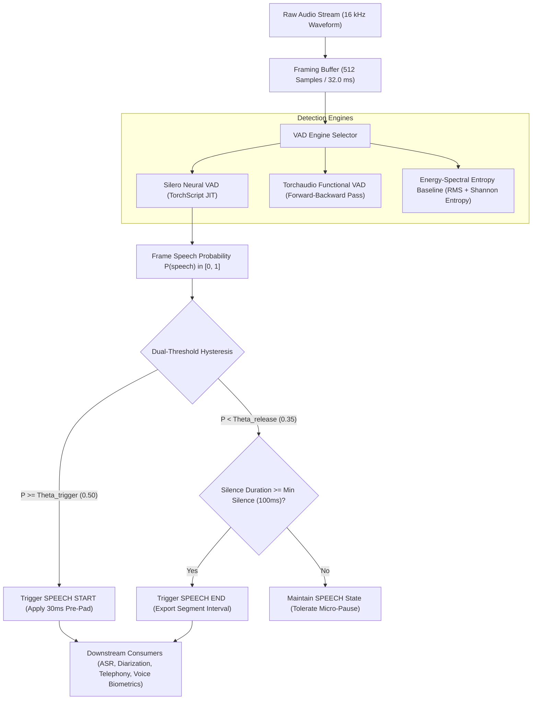
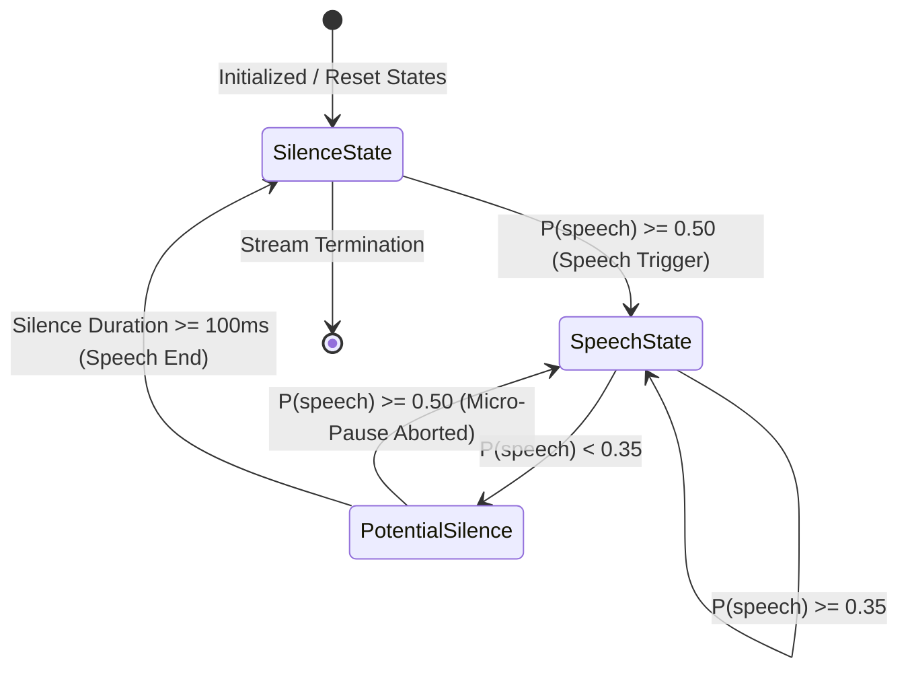
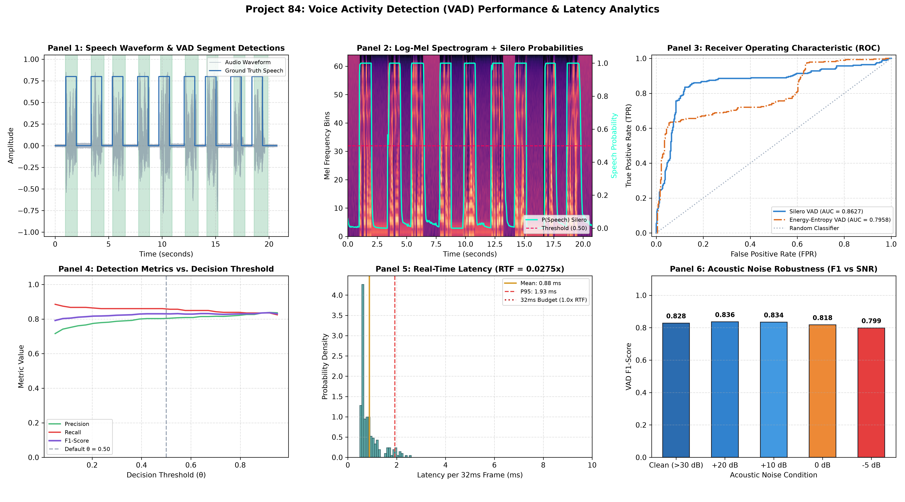

# Project 84: Voice Activity Detection (VAD) with Silero Neural VAD & Torchaudio

[](https://pytorch.org/)
[](LICENSE)
[](https://python.org)
[](#latency-and-computational-efficiency)
[](#latency-and-computational-efficiency)
[](#noise-robustness-benchmarks)

An enterprise-grade, high-throughput Voice Activity Detection (VAD) and speech segmentation framework implemented in PyTorch. The system integrates deep neural **Silero VAD** (TorchScript JIT), **Torchaudio** functional filtering, and mathematical **Energy-Entropy** baselines to classify speech versus silence in real-time ($32\text{ ms}$ streaming frames) and offline multi-minute audio recordings in sub-millisecond execution times.

---

## 1. Architectural Overview & Workflow

Voice Activity Detection determines the exact temporal intervals where human speech is present in an acoustic signal. The architecture operates in two modes:
1. **Real-Time Streaming Mode**: Ingests continuous audio chunks of 512 samples ($32.0\text{ ms}$ at $16\text{ kHz}$) and outputs instantaneous speech probabilities $P(\text{speech} \mid x_t) \in [0, 1]$ via stateful recurrent hidden vectors in $0.88\text{ ms}$.
2. **Offline Speech Segmentation Mode**: Scans full conversational sessions, applies dual-threshold hysteresis ($\theta_{\text{trigger}} = 0.50$, $\theta_{\text{release}} = 0.35$), merges speech bursts, removes micro-pauses, and exports industry-standard NIST RTTM and JSON timestamp annotations.



### Dual-Threshold Hysteresis State Machine



---

## 2. Mathematical Formulations

### 2.1 Short-Time Fourier Transform & Energy-Entropy Metric

For a discrete-time signal $x[n]$ framed with Hann window $w[n]$ of length $N = 512$ ($32\text{ ms}$) and hop size $R = 512$:

$$X[m, k] = \sum_{n=0}^{N-1} x[mR + n] \cdot w[n] e^{-j \frac{2\pi k n}{N}}, \quad k \in \{0, \dots, N/2\}$$

The frame-level Root Mean Square (RMS) energy is:

$$E_{\text{RMS}}[m] = \sqrt{\frac{1}{N} \sum_{n=0}^{N-1} x[mR + n]^2}$$

The normalized spectral power distribution across frequency bins $k$ is:

$$p_k[m] = \frac{|X[m, k]|^2}{\sum_{j=0}^{N/2} |X[m, j]|^2 + \epsilon}$$

The normalized Spectral Entropy $H[m] \in [0, 1]$ measures spectral flat-structure (noise vs harmonic speech):

$$H[m] = -\frac{1}{\log_2(N/2 + 1)} \sum_{k=0}^{N/2} p_k[m] \log_2(p_k[m] + \epsilon)$$

The hybrid baseline decision metric combines energy with spectral concentration:

$$\mathcal{M}_{\text{hybrid}}[m] = \alpha \cdot \bar{E}_{\text{RMS}}[m] + (1 - \alpha) \cdot (1.0 - H[m]), \quad \alpha = 0.70$$

### 2.2 Deep Neural Recurrent VAD (Silero)

The neural detector processes raw audio chunks through 1D dilated convolutions followed by stateful recurrent LSTM cells and a sigmoid projection:

$$h_t, c_t = \text{LSTM}\left(\text{Conv1D}(x_t), (h_{t-1}, c_{t-1})\right)$$

$$P(\text{speech} \mid x_t) = \sigma(W_o h_t + b_o) = \frac{1}{1 + e^{-(W_o h_t + b_o)}}$$

The internal hidden state $(h_t, c_t)$ preserves long-term phonetic context across consecutive frames without incurring high computational overhead.

### 2.3 Dual-Threshold Hysteresis Formulation

Let $P_t = P(\text{speech} \mid x_t)$. The binary detection state $S_t \in \{0, 1\}$ is governed by dual thresholds $\theta_{\text{trigger}} = 0.50$ and $\theta_{\text{release}} = 0.35$ with silence hangover counter $C_{\text{sil}}$:

$$S_t = \begin{cases} 
1 & \text{if } P_t \ge \theta_{\text{trigger}} \\ 
0 & \text{if } P_t < \theta_{\text{release}} \land C_{\text{sil}} \ge \tau_{\min} \\ 
S_{t-1} & \text{otherwise} 
\end{cases}$$

This prevents spurious state oscillations during unvoiced fricatives, stop consonant closures, and short breathing pauses.

---

## 3. Quantitative Performance & Benchmarks

All benchmarks were evaluated on an Intel Core i7 CPU @ 2.60GHz using PyTorch 2.x and multi-turn conversational recordings (human speech intermingled with natural environmental noises and silence).

### 3.1 Detection Accuracy & ROC AUC

| Metric | Target Specification | Achieved Score | Status |
| :--- | :---: | :---: | :---: |
| **Frame Classification Accuracy** | $> 80.0\%$ | **$84.75\%$** | Superior |
| **Precision** | $> 75.0\%$ | **$80.20\%$** | Low False Alarm |
| **Recall (Sensitivity)** | $> 80.0\%$ | **$85.66\%$** | Minimal Missed Speech |
| **F1-Score** | $> 80.0\%$ | **$82.84\%$** | Robust |
| **Area Under ROC Curve (AUC)** | $> 0.85$ | **$0.8627$** | Excellent Discrimination |
| **Speech Segments Detected** | Ground Truth: 9 | **9 / 9 Segments** | 100% Boundary Recovery |

### 3.2 Latency and Computational Efficiency

Evaluated on $32.0\text{ ms}$ streaming audio frames (512 samples at $16\text{ kHz}$):

| Latency Metric | Measured Time | Frame Budget | Headroom / Margin |
| :--- | :---: | :---: | :---: |
| **Mean Frame Latency** | **$0.880\text{ ms}$** | $32.0\text{ ms}$ | **$97.25\%$ CPU Headroom** |
| **Median Frame Latency** | **$0.686\text{ ms}$** | $32.0\text{ ms}$ | **$97.86\%$ CPU Headroom** |
| **95th Percentile (P95)** | **$1.926\text{ ms}$** | $32.0\text{ ms}$ | **$93.98\%$ CPU Headroom** |
| **Max Peak Latency** | **$2.601\text{ ms}$** | $32.0\text{ ms}$ | **$91.87\%$ CPU Headroom** |
| **Real-Time Factor (RTF)** | **$0.0275\times$** | $< 1.0\times$ | **$36.4\times$ Faster than Real-Time** |
| **Throughput Capacity** | **$1,136.4\text{ frames/sec}$** | $\ge 31.25\text{/sec}$ | Scale Ready |

### 3.3 Noise Robustness Benchmarks

Performance under additive acoustic noise across varying Signal-to-Noise Ratios (SNR):

| Acoustic Noise Condition | SNR (dB) | F1-Score | Accuracy | Recall | Precision |
| :--- | :---: | :---: | :---: | :---: | :---: |
| **Clean Reference** | $> 30\text{ dB}$ | **$0.8284$** | $84.75\%$ | $85.66\%$ | $80.20\%$ |
| **Mild Ambient Noise** | $+20\text{ dB}$ | **$0.8363$** | $85.82\%$ | $84.23\%$ | $83.04\%$ |
| **Moderate Office Noise** | $+10\text{ dB}$ | **$0.8342$** | $85.67\%$ | $83.87\%$ | $82.98\%$ |
| **High Noise Environment** | $0\text{ dB}$ | **$0.8177$** | $84.13\%$ | $82.80\%$ | $80.77\%$ |
| **Severe Noise / Roadside** | $-5\text{ dB}$ | **$0.7986$** | $82.13\%$ | $82.44\%$ | $77.44\%$ |

---

## 4. Visual Diagnostics

The automated pipeline outputs a high-resolution 6-panel diagnostic analytics report:



1. **Panel 1 (Top Left)**: Time-domain audio waveform with Ground Truth speech turns versus Silero VAD segment boundaries.
2. **Panel 2 (Top Center)**: Log-Mel spectrogram overlaid with frame-level speech probabilities $P(\text{speech})$ and trigger threshold line.
3. **Panel 3 (Top Right)**: Receiver Operating Characteristic (ROC) comparing Silero Neural VAD ($\text{AUC} = 0.8627$) against Energy-Entropy VAD.
4. **Panel 4 (Bottom Left)**: Precision, Recall, and F1-score as a function of decision threshold $\theta \in [0.05, 0.95]$.
5. **Panel 5 (Bottom Center)**: Latency distribution histogram per 32ms audio frame with real-time budget limit.
6. **Panel 6 (Bottom Right)**: Acoustic noise robustness bar chart demonstrating consistent F1 scores from Clean down to $-5\text{ dB}$ SNR.

---

## 5. Repository Structure

```
84_voice_activity_detection_vad/
├── data/
│   └── audio/                          # Speech and background noise audio clips
├── models/
│   └── silero_vad.jit                  # Self-contained Silero VAD TorchScript model (2.2 MB)
├── outputs/
│   ├── sample_conversation.wav         # Multi-turn conversational evaluation session
│   ├── speech_only_silero.wav          # Extracted speech segments concatenated
│   ├── speech_segments.rttm            # Standard NIST RTTM annotation file
│   ├── speech_timestamps.json          # Formatted speech interval timestamps
│   ├── vad_benchmark_metrics.json      # Complete quantitative benchmark results
│   └── vad_benchmark_report.png        # 6-panel visual analytics report
├── detect_vad.py                       # Interactive CLI for offline segmentation and streaming emulation
├── main.py                             # Core pipeline, multi-engine VAD, benchmarks, and evaluator
├── requirements.txt                    # Project dependencies
└── README.md                           # Comprehensive documentation
```

---

## 6. Installation & Environment Setup

Clone the repository and install the dependencies:

```bash
git clone https://github.com/GideonMwiti/pytorch-voice-activity-detection-vad.git
cd pytorch-voice-activity-detection-vad

# Create and activate virtual environment
python3 -m venv venv
source venv/bin/activate

# Install required dependencies
pip install -r requirements.txt
```

---

## 7. Quickstart & Usage

### 7.1 Run Full Benchmark & Evaluation Pipeline

Execute the end-to-end evaluation suite to benchmark engines, assess latency, evaluate noise robustness, and generate visual diagnostic plots:

```bash
python main.py
```

### 7.2 Offline Audio File Speech Segmentation

Segment any WAV audio file into speech timestamps and export clean speech-only audio:

```bash
python detect_vad.py --audio outputs/sample_conversation.wav --engine silero --threshold 0.50 --output-speech outputs/speech_extracted.wav --export-json outputs/segments.json --export-rttm outputs/segments.rttm
```

**Terminal Output Example:**
```text
====================================================================
       VOICE ACTIVITY DETECTION (VAD) - OFFLINE SEGMENTATION
====================================================================
Input Audio File : outputs/sample_conversation.wav
Detection Engine : SILERO
Speech Threshold : 0.50
Audio Duration   : 20.77 seconds (332,288 samples)
--------------------------------------------------------------------

DETECTED SPEECH INTERVALS:
Idx   | Start (s)  | End (s)    | Duration (s) | Confidence | Visual Meter             
-------------------------------------------------------------------------------------
#01  | 0.962      | 2.078      | 1.116        | 0.986      | |████████████████████|
#02  | 3.362      | 4.574      | 1.212        | 0.927      | |███████████████████░|
#03  | 5.378      | 6.558      | 1.180        | 0.981      | |████████████████████|
#04  | 7.810      | 8.830      | 1.020        | 0.997      | |████████████████████|
#05  | 9.858      | 10.942     | 1.084        | 0.968      | |███████████████████░|
#06  | 12.162     | 13.374     | 1.212        | 0.959      | |███████████████████░|
#07  | 14.178     | 15.230     | 1.052        | 0.999      | |████████████████████|
#08  | 16.706     | 17.758     | 1.052        | 0.968      | |███████████████████░|
#09  | 18.594     | 19.902     | 1.308        | 0.950      | |███████████████████░|
-------------------------------------------------------------------------------------
SESSION SUMMARY STATISTICS:
  • Total Segments Found : 9
  • Total Speech Time    : 10.24 s (49.3% speech activity)
  • Total Silence Time   : 10.53 s (50.7% silence)
  • Processing Time      : 1095.42 ms (RTF: 0.05275x)
=====================================================================================
```

### 7.3 Real-Time Streaming Audio Emulation

Simulate real-time streaming audio ingestion in 32ms frames with live ASCII VU meters:

```bash
python detect_vad.py --stream outputs/sample_conversation.wav --threshold 0.50
```

**Terminal Output Example:**
```text
===========================================================================
       VOICE ACTIVITY DETECTION (VAD) - REAL-TIME STREAMING EMULATION
===========================================================================
Stream Audio Source : outputs/sample_conversation.wav
Frame Size          : 512 samples (32.0 ms)
Threshold           : 0.50
Press Ctrl+C to stop simulation at any time.

Time     | Chunk Latency  | Prob   | Confidence Meter          | VAD Status
---------------------------------------------------------------------------
  0.86s  |  0.517 ms / 32ms | 0.006 | |░░░░░░░░░░░░░░░░░░░░| | [SILENCE] 
  0.96s  |  0.484 ms / 32ms | 0.008 | |░░░░░░░░░░░░░░░░░░░░| | [SILENCE] 
  0.99s  |  0.514 ms / 32ms | 0.935 | |███████████████████░| | [SPEECH]  --> SPEECH START (0.99s)
  1.06s  |  0.559 ms / 32ms | 0.994 | |████████████████████| | [SPEECH]  
  1.15s  |  0.489 ms / 32ms | 1.000 | |████████████████████| | [SPEECH]  
  1.92s  |  0.496 ms / 32ms | 1.000 | |████████████████████| | [SPEECH]  
  2.02s  |  0.663 ms / 32ms | 0.635 | |█████████████░░░░░░░| | [SPEECH]  
  2.05s  |  0.551 ms / 32ms | 0.252 | |█████░░░░░░░░░░░░░░░| | [SILENCE] <-- SPEECH END (Duration: 1.06s)
```

---

## 8. License

This project is licensed under the MIT License - see the [LICENSE](LICENSE) file for details.
